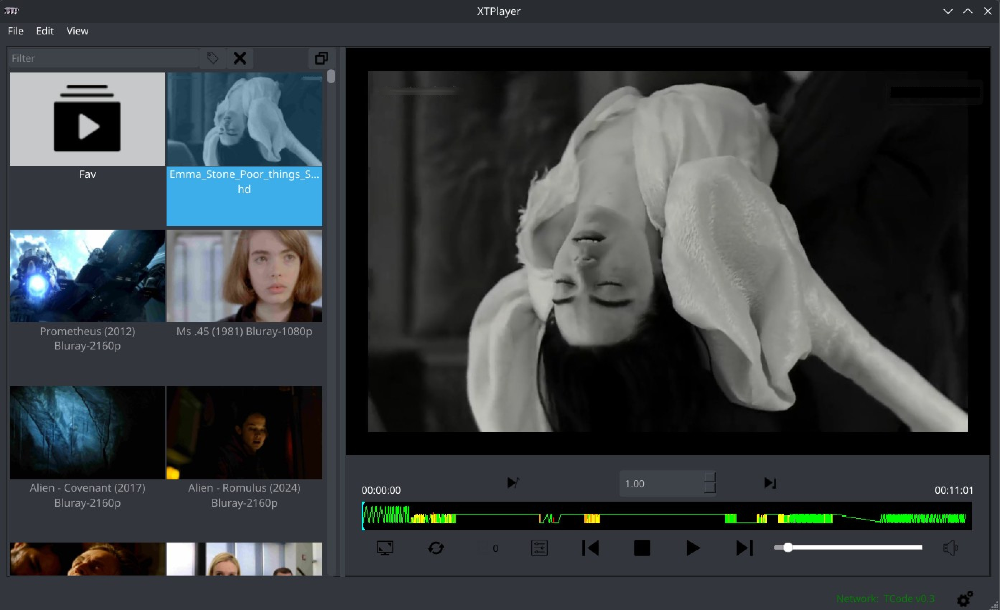

# XTPlayer
XTPlayer is a cross platform TCode media player. 


## Features: 
    * Sync VR/2d/audio/stand alone funscripts with any robot that runs under the TCode standard V2 or V3 
    * Load a folder with videos for easy access.
    * Built in funscript to TCode conversion
    * Load any funscript with any video
    * Customize the player looks via an "easy" CSS like syntax.
    * Add psuedo random motion to TCode's other axis' via the current funscript pos
    * Control the app and TCode devices with a gamepad
    * Sync with DeoVR/HereSphere and Whirligig VR meadia players
    * Built in web server for viewing media collection with a variaty of devices.
    * And much more
    
## Installing from [release package](https://github.com/jcfain/XTPlayer/releases/latest)
      1. Grab the latest release package for your OS from the release section on this page. https://github.com/jcfain/XTPlayer/releases/latest.
      2. On windows, extract the zip to a place where your user has permissions to.
      3. Run the executable.
      4. Choose at least one path to the media/funscripts to add.
      5. The application will scan the directory and all subdirectories for media and their funscripts then start generating thumbnails. This can take sometime on first startup depending on how many files you have.

### Linux: Flatpak

A self-contained Flatpak build (x86_64 and aarch64) is published alongside each release. It bundles Qt6, an AV1-capable FFmpeg, and the web UI, and runs on the standard `org.freedesktop.Platform` base (downloaded from Flathub on first install).

1. [Install Flatpak](https://docs.flatpak.org/en/latest/getting-started.html) if you don't already have it.
2. Download the `xtp-flatpak-<arch>-<version>.flatpak` asset for your architecture from the [release](https://github.com/jcfain/XTPlayer/releases/latest) page.
3. Install it:
   ```
   flatpak install xtp-flatpak-x86_64-<version>.flatpak
   ```
   (most desktop file managers will also let you double-click the `.flatpak` file.)
4. Launch **XTPlayer** from your app menu (app id `io.github.jcfain.XTPlayer`).

## System requirements

Minimum OS for each build (all 64-bit):

| Platform | Minimum OS | Notes |
|----------|-----------|-------|
| Windows x86_64 | Windows 10 (version 1903+) or Windows 11 | |
| macOS (universal) | macOS 14.4 (Sonoma) or later | Runs on both Intel (x86_64) and Apple Silicon (arm64); the bundled Qt 6.12 dylibs are built for 14.4, which is the app's true floor |
| Linux x86_64 (AppImage) | glibc 2.39+ (Ubuntu 24.04+ / Debian 13+) | The AppImage bundles the build host's system libraries (built on Ubuntu 24.04) but not glibc itself, so the target needs a matching-or-newer glibc |
| Linux aarch64 (ARM64, AppImage) | glibc 2.39+ (Ubuntu 24.04+ / Debian 13+) | Same note, on ARM64 hardware |

The **Flatpak** is self-contained: it runs on the `org.freedesktop.Platform` base (pulled from Flathub on install), which bundles its own glibc and system libraries, so the glibc requirement above does **not** apply. It only needs [Flatpak](https://docs.flatpak.org/en/latest/getting-started.html) installed (plus a one-time download of the base from Flathub).

(Building from source with Qt 6.12 needs only glibc 2.34+ on Linux.)

## CI builds (GitHub Actions)
* **Nightly** — built daily at 02:00 UTC (and on demand via the Actions "Run workflow" button) from `Development` (XTEngine `Development`). Published to the rolling [`nightly` release](https://github.com/jcfain/XTPlayer/releases/tag/nightly).
* **Release** — built from `main` (XTEngine `main`) whenever a `v*` tag is pushed (`git tag v0.6.10 && git push origin v0.6.10`).
* Artifacts: Linux x86_64 + aarch64 AppImages, Windows x86_64 zip, macOS universal (arm64 + x86_64) DMG. All bundle an AV1-capable FFmpeg build (dav1d/aom + hwaccel), so no separate codec pack is needed.
* The Angular web bundle is built in CI from `XTEngine/src/wwwsrc` — no manual www deploy/commit needed.

### macOS: first launch (ad-hoc signed)

The macOS DMG is **ad-hoc signed** (built without an Apple Developer account), so
macOS Gatekeeper blocks it on first launch. To run it:

* **Easiest:** right-click (or Control-click) `XTPlayer.app` → **Open** → click **Open**
  again in the dialog. You only need to do this once.
* **Or via Terminal:** remove the quarantine attribute, then launch normally:
  ```
  xattr -d com.apple.quarantine /Applications/XTPlayer.app
  ```

After the first approved launch the app opens normally like any other.

## Building from source
     1. Download and install the following apps
          *  QT Creator Community Open source edition: https://www.qt.io/download 
             During installation, make sure to get Qt 6.11. with the aditional libraries: HTTP Server, Serial port, Speech, Connectivity, MultiMedia, Image formats, Wayland(Linux) and WebSockets.
     2. Required libraries needed:
          * https://github.com/pumphaus/qtgamepadlegacy
               * You can make/makeinstall or open CMakeLists.txt in Qt creator and build. Then open the build dir and execute "make install". Make sure to build release if you dont plan to debug it. 
                 You can also manually copy the folders ./bin, ./include etc to the Qt directory of the same names.
      You may need to check the XTEngine.pro and XTPlayer.pro build files for specific library directories. See the win32 section for windows.
      If you have trouble building these I added a couple files in the "dependencies" directory of this repo for reminders.
      3. Clone/download XTPlayer https://github.com/jcfain/XTPlayer/ and XTEngine https://github.com/jcfain/XTEngine/ source into the same directory.
      4. Open the XTEngine and XTPlayer projects in Qt Creator
      5. Select XTPlayer click Projects on the rightside then Dependencies and select XTEngine and check sync.
      6. Select the "Build" item under "Desktop Qt 6.11" and change the Build directory to "path to"/git/XTPlayer/build-release 
      7. Do the same for XTEngine but set it to "path to"git/XTEngine/build-release.
      8. Do the same for the debug build if you want to build debug.
      9. You should be able to build now.
          
 ## Deploying
      1. In the root directory of this repository there is a file named "win_release_deploy-release.bat"
         You may want to edit the file and make sure your directories are the same first.
      2. Double click this file to run.
      3. Make sure all commands say at least "1 files copied".
      4. The newly deployed app should be in a newly created dir ".\bin\release"
      5. You should be able to ship this directory to any windows 64 pc.
    


